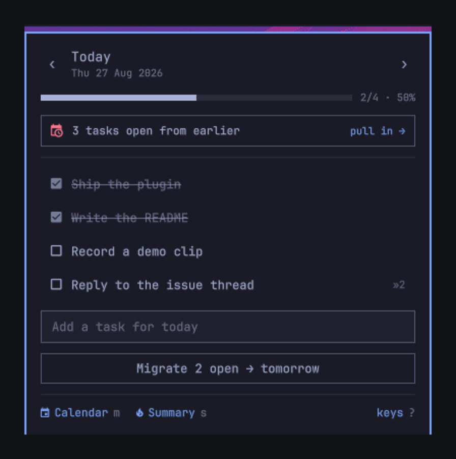
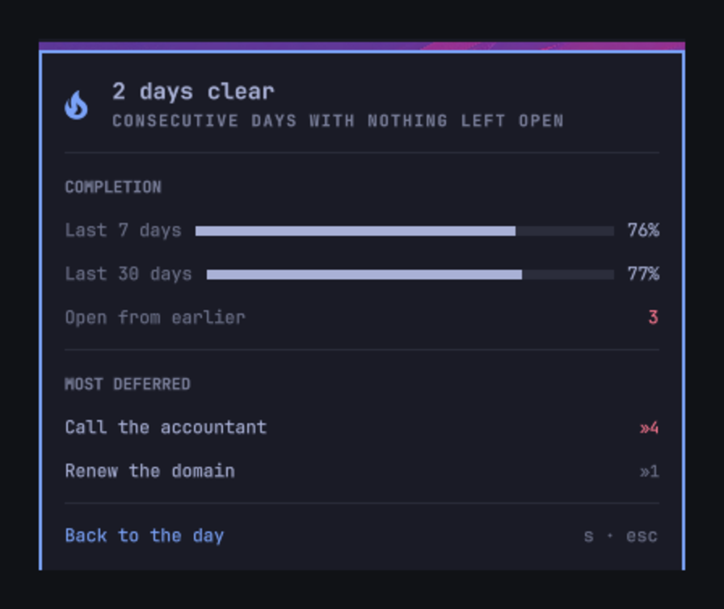
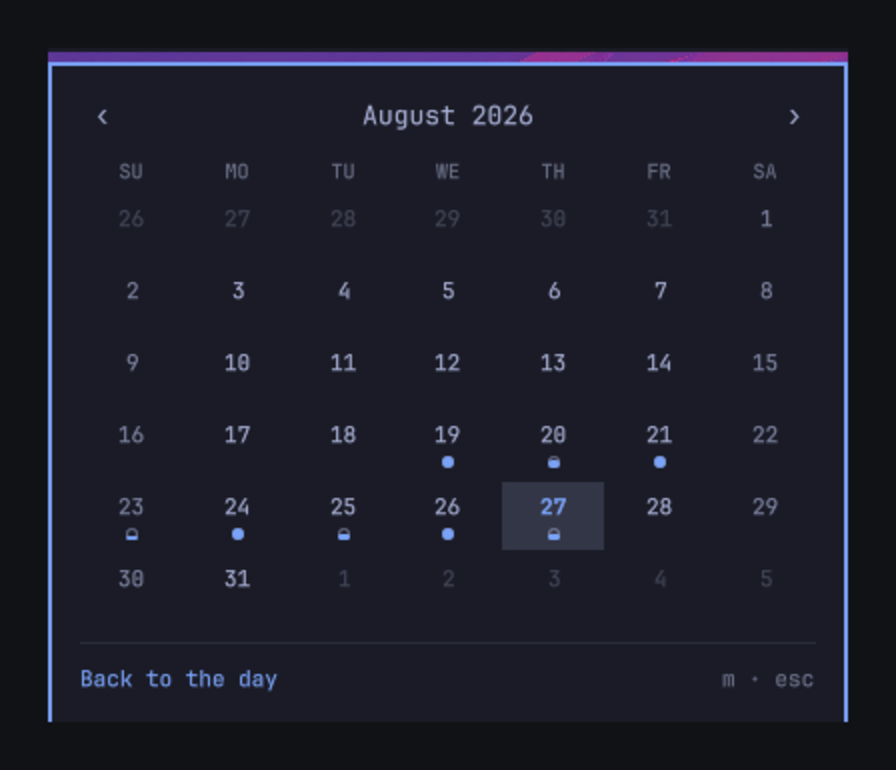
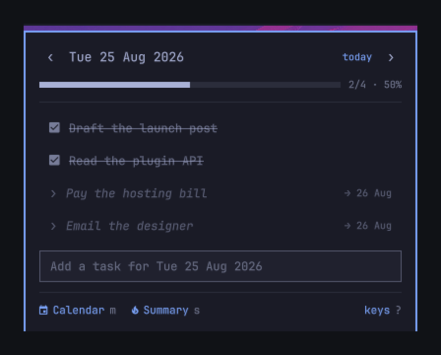

# Bujo

**A bullet journal in the Omarchy bar. Tasks belong to a day, and what you don't
finish gets migrated forward — deliberately, by you.**


Every other task widget is a flat list or a board: things are either done or
they aren't, and nothing records that you have now rewritten *call the
accountant* four days running. A bullet journal is a different instrument. Work
belongs to a date. At the end of the day you look at what is left and decide,
one item at a time, whether it is worth carrying forward. That decision is the
practice — and it is what this puts in the bar.

Plugin id: `io.github.ipastorsan.bujo`

## Install

```bash
omarchy plugin add https://github.com/IpastorSan/omarchy-plugin-bujo.git --enable
```

Move it if you'd rather it sat somewhere else:

```bash
omarchy bar move io.github.ipastorsan.bujo --section right
```

No dependencies beyond Omarchy itself. Nothing leaves your machine.

## What you get

**The pill** shows today at a glance — `󰄱 2/5` — and goes to a checked box when
the day is clear. It dims on a day you have not written anything on.


**The day view** is the list: click a box to strike it through, type in the
field to add. `‹` and `›` walk through dates; the completion rail and `2/5 ·
40%` say how the day is going.



**Migration** is the point. The button names where things land, always —
`Migrate 3 open → tomorrow` on today, `→ today` on a day in the past. And when
anything is still open from an earlier day, today's view opens with a banner:

> **2 tasks open from earlier** — pull in →

One click and the whole backlog is on today. That is the daily ritual, and it
takes a second.

**Migrated tasks keep their history.** A task carries the date it was first
written and a count of how many times it has been pushed. Four migrations shows
as `»4` in red — the journal telling you to either do it or drop it. The
**summary view** (`s`) ranks exactly those: your most-deferred work, alongside
7- and 30-day completion and a streak of days you finished clean.



**The calendar** (`m`) is a month of dots: hollow for a day you wrote on and
finished nothing, filling as the ratio climbs, solid when you cleared it. Click
any day to open it.



### What migrating does *not* do

It does not erase the entry from the day it was written on. That day keeps the
line, struck through with `›` and pointing at where the work went:



This is deliberate, and it is the reason the percentages mean anything. Delete
the open tasks instead and every day you ever migrated from reads 100%, because
all that is left on it is the work you finished. The 25th was a half-finished
day. It says so, permanently.

## Keys

The panel is keyboard-first. Open it and:

| | |
|---|---|
| `j` `k` / `↓` `↑` | move down and up the list |
| `space` / `enter` | tick the task off |
| `e` | rename it in place |
| `x` | delete it |
| `J` `K` | reorder |
| `a` / `i` | jump to the add field |
| `h` `l` / `←` `→` | previous and next day |
| `g` | back to today |
| `m` | month calendar |
| `s` | summary |
| `c` | migrate this day |
| `?` | show the key list in the panel |
| `esc` | close |

Right-click the pill to jump to today without opening anything; middle-click to
open straight into the add field.

### A global shortcut

Optional, and never installed for you:

```bash
~/.config/omarchy/plugins/io.github.ipastorsan.bujo/bin/setup-keybind
```

Binds `SUPER + SHIFT + J` in `~/.config/hypr/bindings.lua`, backing the file up
first and restoring it if Hyprland refuses to reload. `--key "SUPER + B"` picks
a different one; `--remove` takes it back out. Running it twice leaves one
binding, not two.

## From the command line

The panel registers an IPC target, so it scripts:

```bash
omarchy-shell bujo add "call the accountant"   # capture onto today
omarchy-shell bujo migrate                     # pull the backlog onto today
omarchy-shell bujo today                       # open, on today
omarchy-shell bujo day 2026-08-25              # open a specific date
omarchy-shell bujo view month                  # day | month | summary
omarchy-shell bujo toggle
omarchy-shell bujo status                      # JSON: counts, streak, backlog
```

`add` always lands on today, whatever the panel happens to be showing.

## Settings

Right-click the bar → widget settings, or edit the entry in
`~/.config/omarchy/shell.json`:

| Setting | Default | |
|---|---|---|
| `pillMode` | `ratio` | `ratio` (`2/5`), `count` (tasks left), `percent`, or `icon` |
| `weekStartDay` | `locale` | `locale`, `monday`, or `sunday` |
| `dimWhenEmpty` | `true` | dim the pill on a day with nothing written |
| `showMigrationMarks` | `true` | show the `»n` deferral count |
| `statePath` | `""` | where the journal lives |

## Your data

One JSON file, keyed by date, written atomically:

```
~/.local/state/omarchy/bujo/tasks.json
```

```json
{
  "version": 1,
  "days": {
    "2026-08-27": [
      {
        "id": "mtbaqzdk-7d703430-0",
        "root": "mtbaqzdk-7d703430-0",
        "text": "Ship the plugin",
        "done": false,
        "createdAt": "2026-08-25T09:14:00.000Z",
        "doneAt": null,
        "origin": "2026-08-25",
        "migrations": 2,
        "migratedTo": null,
        "migratedAt": null,
        "updatedAt": "2026-08-27T09:14:00.000Z",
        "deleted": false,
        "deletedAt": null
      }
    ]
  }
}
```

Keys are sorted and the file is indented, so it diffs cleanly under git. A
corrupt or truncated file loads as an empty journal rather than taking the shell
down with it.

The plugin ships **single-device**: `statePath` is empty, the journal lives in
the local state directory, and nothing syncs. To use it on more than one
machine, see below.

## Using it on more than one device

The journal is one JSON file, so any file-sync tool moves it. Point `statePath`
at a synced folder on each machine and they share one journal:

```bash
omarchy-shell shell setBarWidget io.github.ipastorsan.bujo \
  statePath '"/home/YOU/Sync/bujo/tasks.json"' '{}'
```

Use the same path on every machine, pointed at the same synced directory
(Syncthing, Dropbox, a git checkout — anything that reproduces the file). Set it
back to `'""'` to go local again.

**Changing `statePath` carries your existing journal with you.** The panel keeps
what it is holding and merges it into whatever is at the new location, so
switching a machine over to a shared folder brings its history along rather than
stranding it. That is what you want the first time. It also means pointing at a
path expecting a clean slate will not give you one — empty the journal first, or
point somewhere the tasks are welcome.

**The two devices merge rather than overwrite.** When the file changes
underneath it, the panel does not adopt the new contents wholesale — it combines
them with what it already has and, if its own side had anything the file did
not, writes the result back so the other machine learns about it too. So editing
on both machines while both are offline does not cost you a task.

What each field does when the two machines disagree:

| | |
|---|---|
| A task only one machine has | kept |
| Finished on either | finished, keeping the earlier completion time |
| Deleted on either | deleted — this outranks finished |
| Edited on both | the later edit wins, by `updatedAt` |
| Migrated on both, to any days | one task, not two |
| `migrations` count | the higher one |
| Order within a day | stays local — it is what `J`/`K` control |

Two consequences worth knowing:

- **Deleting is a soft delete.** The entry stays in the file marked `deleted`
  until it is 30 days old, then it is pruned. Without the marker a merge cannot
  tell "new over there" from "deleted over here", and every task you deleted on
  one machine would be resurrected by the other. Deleted tasks never appear in
  the list, the counts, or the calendar.
- **A task keeps its identity across migrations.** Every entry carries a `root`
  alongside its `id`: the id names one copy on one day, the root names the work
  itself and survives every hop. If two machines migrate the same task to
  *different* days, the copies have different ids but the same root, so the
  merge recognises them as one task and folds them together — the copy on the
  earliest day survives, having first absorbed anything done to its siblings, so
  a completion or a rename made on the losing copy is not thrown away. The
  survivor may land on a day already past, in which case it simply shows up in
  the backlog banner and you pull it forward again.

### What it does not do

Order within a day is not merged — it stays local, because that is what `J`/`K`
control and a canonical sort would mean one machine silently rearranging the
other's list on every meeting.

Nothing here is a substitute for the sync tool doing its job. If Syncthing hands
you a `.sync-conflict-*` file, the plugin never sees it; the merge only runs on
the file `statePath` points at. Delete the conflict copy, or merge it in by
hand.

### Device identity

Each machine generates four random hex bytes on first run and stores them at:

```
~/.local/state/omarchy/bujo/device
```

Task ids embed it (`mtbaqzdk-7d703430-0`). This is what stops two machines that
add a task in the same millisecond from minting the same id, which under a merge
would fuse two unrelated tasks into one. The path is fixed and **local on
purpose** — it must not be inside the synced folder, and `statePath` does not
move it. If you clone a machine's whole home directory, delete this file on the
clone so it generates its own.

`omarchy-shell bujo status` reports both the device id and the journal path, and
is the first thing to check if two machines are not converging.

## Remove

```bash
omarchy plugin remove io.github.ipastorsan.bujo
```

Your journal is left where it is. To delete it too:

```bash
rm -rf ~/.local/state/omarchy/bujo
```

## Development

```bash
just            # lint, unit tests, manifest + QML checks
just test       # node --test — the migration and stats logic
just restart    # sync into the live shell, restart it, query the IPC target
```

Saving a file under `~/.config/omarchy/plugins/` hot-reloads the plugin — the
shell watches the tree with `inotifywait -m -r` on a 150 ms debounce. `just
install-dev` is usually the whole loop; the bar pill picks up the new code
without a restart.

Three things worth knowing before you debug this:

- `qmllint` only distinguishes "parses" from "does not", and both it and
  `qmlformat` hard-fail on any file containing a Quickshell `IpcHandler` —
  including Omarchy's own. `just restart` followed by `omarchy-shell bujo
  status` is the check that actually proves the QML loaded.
- `omarchy-shell shell rescanPlugins` does **not** evict a component that failed
  to compile. After a load *error*, a fixed file keeps reporting the old error
  until the shell restarts. This is the one case that genuinely needs `just
  restart`.
- **The IPC target does not survive a hot reload.** A bar widget is instantiated
  once per monitor, so two `IpcHandler`s compete for the `bujo` target and one
  loses with a warning. After a reload the target is stranded on an instance
  whose surface is gone: `omarchy-shell bujo open` reports success and shows
  nothing. Mutating calls like `add` still work, and clicking the pill still
  works — only IPC-driven *opening* is affected. Restart before testing the
  panel through IPC.

## License

MIT. See [LICENSE](LICENSE).
