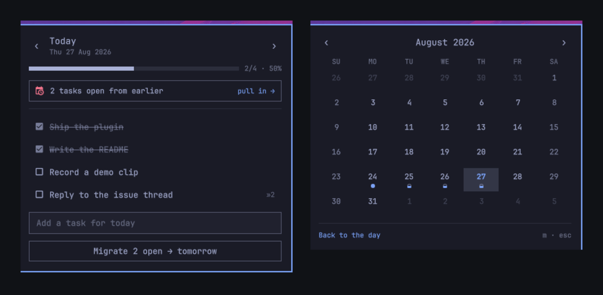

# Bujo

**A bullet journal in the Omarchy bar. Tasks belong to a day, and what you don't
finish gets migrated forward — deliberately, by you.**



Every other task widget is a flat list or a board: things are either done or
they aren't, and nothing records that you have now rewritten *call the
accountant* four days running. A bullet journal is a different instrument. Work
belongs to a date. At the end of the day you look at what is left and decide,
one item at a time, whether it is worth carrying forward. That decision is the
practice — and it is what this puts in the bar.

Plugin id: `io.github.ipastorsan.bujo`

## Install

```bash
omarchy plugin add https://github.com/IpastorSan/omarchy-plugin-bujo.git --enable
```

Move it if you'd rather it sat somewhere else:

```bash
omarchy bar move io.github.ipastorsan.bujo --section right
```

No dependencies beyond Omarchy itself. Nothing leaves your machine.

## What you get

**The pill** shows today at a glance — `󰄱 2/5` — and goes to a checked box when
the day is clear. It dims on a day you have not written anything on.

**The day view** is the list: click a box to strike it through, type in the
field to add. `‹` and `›` walk through dates; the completion rail and `2/5 ·
40%` say how the day is going.

**Migration** is the point. The button names where things land, always —
`Migrate 3 open → tomorrow` on today, `→ today` on a day in the past. And when
anything is still open from an earlier day, today's view opens with a banner:

> **2 tasks open from earlier** — pull in →

One click and the whole backlog is on today. That is the daily ritual, and it
takes a second.

**Migrated tasks keep their history.** A task carries the date it was first
written and a count of how many times it has been pushed. Four migrations shows
as `»4` in red — the journal telling you to either do it or drop it. The
**summary view** (`s`) ranks exactly those: your most-deferred work, alongside
7- and 30-day completion and a streak of days you finished clean.

**The calendar** (`m`) is a month of dots: hollow for a day you wrote on and
finished nothing, filling as the ratio climbs, solid when you cleared it. Click
any day to open it.

### What migrating does *not* do

It does not erase the entry from the day it was written on. That day keeps the
line, struck through with `›` and pointing at where the work went:

```
Tue 25 Aug 2026                     2/4 · 50%
  ☑ Draft the plan
  ☑ Read the API
  › Call the bank                     → 27 Aug
  › Renew the domain                  → 27 Aug
```

This is deliberate, and it is the reason the percentages mean anything. Delete
the open tasks instead and every day you ever migrated from reads 100%, because
all that is left on it is the work you finished. The 25th was a half-finished
day. It says so, permanently.

## Keys

The panel is keyboard-first. Open it and:

| | |
|---|---|
| `j` `k` / `↓` `↑` | move down and up the list |
| `space` / `enter` | tick the task off |
| `e` | rename it in place |
| `x` | delete it |
| `J` `K` | reorder |
| `a` / `i` | jump to the add field |
| `h` `l` / `←` `→` | previous and next day |
| `g` | back to today |
| `m` | month calendar |
| `s` | summary |
| `c` | migrate this day |
| `?` | show the key list in the panel |
| `esc` | close |

Right-click the pill to jump to today without opening anything; middle-click to
open straight into the add field.

### A global shortcut

Optional, and never installed for you:

```bash
~/.config/omarchy/plugins/io.github.ipastorsan.bujo/bin/setup-keybind
```

Binds `SUPER + SHIFT + J` in `~/.config/hypr/bindings.lua`, backing the file up
first and restoring it if Hyprland refuses to reload. `--key "SUPER + B"` picks
a different one; `--remove` takes it back out. Running it twice leaves one
binding, not two.

## From the command line

The panel registers an IPC target, so it scripts:

```bash
omarchy-shell bujo add "call the accountant"   # capture onto today
omarchy-shell bujo migrate                     # pull the backlog onto today
omarchy-shell bujo today                       # open, on today
omarchy-shell bujo day 2026-08-25              # open a specific date
omarchy-shell bujo view month                  # day | month | summary
omarchy-shell bujo toggle
omarchy-shell bujo status                      # JSON: counts, streak, backlog
```

`add` always lands on today, whatever the panel happens to be showing.

## Settings

Right-click the bar → widget settings, or edit the entry in
`~/.config/omarchy/shell.json`:

| Setting | Default | |
|---|---|---|
| `pillMode` | `ratio` | `ratio` (`2/5`), `count` (tasks left), `percent`, or `icon` |
| `weekStartDay` | `locale` | `locale`, `monday`, or `sunday` |
| `dimWhenEmpty` | `true` | dim the pill on a day with nothing written |
| `showMigrationMarks` | `true` | show the `»n` deferral count |
| `statePath` | `""` | where the journal lives |

## Your data

One JSON file, keyed by date, written atomically:

```
~/.local/state/omarchy/bujo/tasks.json
```

```json
{
  "version": 1,
  "days": {
    "2026-08-27": [
      {
        "id": "mtb8jv78-0",
        "text": "Ship the plugin",
        "done": false,
        "createdAt": "2026-08-25T09:14:00.000Z",
        "doneAt": null,
        "origin": "2026-08-25",
        "migrations": 2,
        "migratedTo": null
      }
    ]
  }
}
```

Keys are sorted and the file is indented, so it diffs cleanly under git. Point
`statePath` at a synced or version-controlled folder and the journal follows you
between machines — the panel watches the file and picks up outside edits, and
re-reads whenever you open it.

A corrupt or truncated file loads as an empty journal rather than taking the
shell down with it.

## Remove

```bash
omarchy plugin remove io.github.ipastorsan.bujo
```

Your journal is left where it is. To delete it too:

```bash
rm -rf ~/.local/state/omarchy/bujo
```

## Development

```bash
just            # lint, unit tests, manifest + QML checks
just test       # node --test — the migration and stats logic
just restart    # sync into the live shell, restart it, query the IPC target
```

Two things worth knowing before you debug this:

- `qmllint` only distinguishes "parses" from "does not", and both it and
  `qmlformat` hard-fail on any file containing a Quickshell `IpcHandler` —
  including Omarchy's own. `just restart` followed by `omarchy-shell bujo
  status` is the check that actually proves the QML loaded.
- `omarchy-shell shell rescanPlugins` does **not** evict a component that failed
  to compile. After a load error, a fixed file will keep reporting the old error
  until you restart the shell.

## License

MIT. See [LICENSE](LICENSE).
